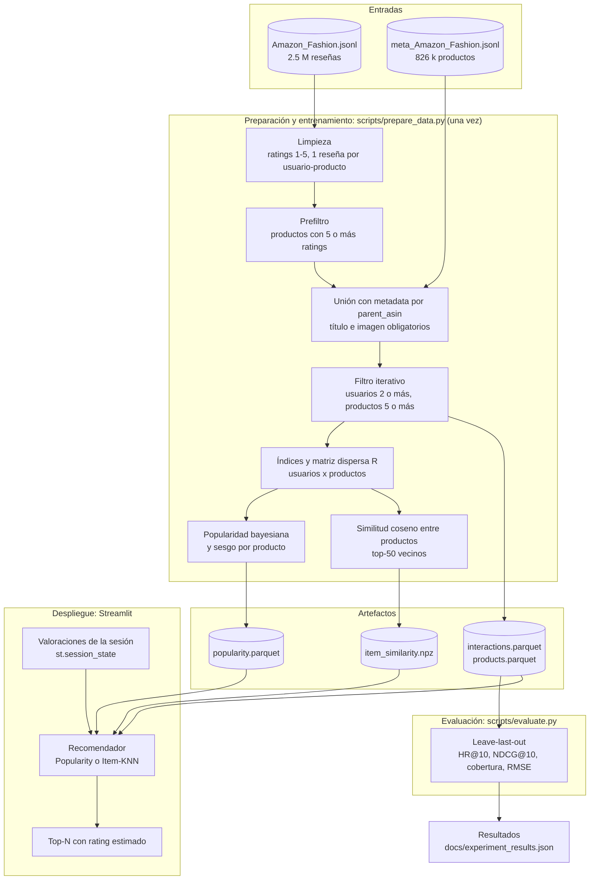
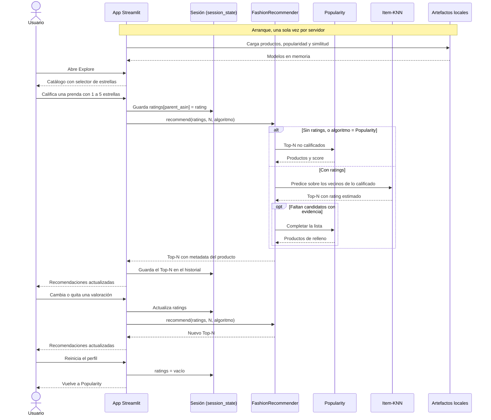

# FashionRec: recomendador de moda con filtrado colaborativo

**Autores:** [completar nombres] · **Curso:** [completar curso] · **Fecha:** 3 de noviembre de 2026

## 1. Introducción

Las tiendas de moda en línea tienen catálogos de miles de prendas y la mayoría de los usuarios califica muy pocas.
Mostrar solo lo más popular es simple, pero entrega la misma lista a todos. El filtrado colaborativo personaliza
usando las valoraciones de otros usuarios, aunque necesita historial del usuario y su rendimiento se ve afectado cuando los datos son muy dispersos.

FashionRec aborda ese problema con reseñas reales de Amazon Fashion. Compara dos enfoques, **Popularity-Based** y
**Item-Based Collaborative Filtering (Item-KNN)**, dentro de una aplicación Streamlit donde el usuario califica prendas
y ve cómo cambia su Top-N al instante. El proyecto permite ver, con datos reales, cómo evoluciona la
personalización desde un usuario sin historial hasta uno con varias valoraciones.

## 2. Objetivo

**General.** Construir una aplicación que recomiende prendas de Amazon Fashion con filtrado colaborativo basado en ítems
y actualice las recomendaciones a medida que el usuario las califica.

**Específicos.**

1. Generar con un solo script un subconjunto limpio de al menos 20 000 usuarios y 4 000 productos con título e imagen.
2. Lograr que Item-KNN supere a Popularity-Based en HR@10 en una evaluación *leave-last-out* sobre todos los usuarios.

## 3. Descripción de los datos

**Fuente.** [Amazon Reviews 2023](https://amazon-reviews-2023.github.io/), categoría *Amazon Fashion* (McAuley Lab, UCSD).
Se descarga con `python scripts/download_data.py` desde Hugging Face (`McAuley-Lab/Amazon-Reviews-2023`).

| | Reseñas | Metadata |
| --- | --- | --- |
| Archivo | `Amazon_Fashion.jsonl` | `meta_Amazon_Fashion.jsonl` |
| Tamaño | 1.0 GB · 2 500 939 reseñas | 1.4 GB · 826 108 productos |
| Formato | JSON Lines | JSON Lines |
| Variables usadas | `user_id`, `parent_asin`, `rating` (1-5), `timestamp` | `parent_asin`, `title`, `store`, `average_rating`, `rating_number`, `price`, `details.Department`, `images` |

El identificador de producto es `parent_asin` en ambos archivos.

**Preprocesamiento** (detalle en [`docs/PREPARE_DATA.md`](docs/PREPARE_DATA.md)):

1. Se eliminan nulos y ratings fuera de 1-5, y se deja una reseña por par usuario-producto (la más reciente).
2. Se une la metadata y se exige título e imagen.
3. Filtro iterativo: usuarios con ≥ 2 ratings y productos con ≥ 5.
4. Se infieren categoría y departamento a partir del título.

| Subconjunto resultante | |
| --- | --- |
| Usuarios · Productos · Ratings | 21 034 · 4 823 · 50 457 |
| Dispersión de la matriz | 99.95 % |
| Ratings por usuario · por producto (promedio) | 2.4 · 10.5 |
| Distribución de estrellas (1 a 5) | 7.5 % · 5.5 % · 10.7 % · 18.0 % · 58.3 % |
| Periodo de las reseñas | 2007 a 2023 |

**Limitaciones y sesgos.**

* **No se usó 5-core.** El 86 % de los usuarios tiene una sola reseña y el 5-core estricto deja el dataset vacío; por eso usuarios ≥ 2.
* **Sesgo hacia ratings altos** (58 % son 5★) y hacia joyería (37 % del catálogo) y accesorios (15 %).
* **Categorías aproximadas.** La metadata trae `categories` vacío; se infieren del título con palabras clave en inglés y algunos productos quedan en «Otros».
* **Precio casi inexistente** (80 % nulo), por lo que no se usa.
* **Imágenes remotas** servidas por Amazon: sin internet las tarjetas se ven sin imagen.

**Licencia y uso.** La tarjeta del dataset no declara una licencia explícita. Las reseñas, imágenes y marcas pertenecen a Amazon y a sus autores,
y el proyecto lo usa solo con fines académicos. Antes de cualquier uso comercial o de redistribución de `data/processed/` hay que revisar sus términos.
Cita original: Hou et al., *Bridging Language and Items for Retrieval and Recommendation*, arXiv:2403.03952, 2024.

## 4. Metodología

**Etapas.** (1) Preparación de datos y (2) entrenamiento ocurren una sola vez en `prepare_data.py`. (3) La evaluación offline se hace con
`evaluate.py`. (4) El despliegue es una app Streamlit que carga los artefactos y calcula las recomendaciones en cada interacción.



*Figura 1. Flujo metodológico de principio a fin: entradas, procesos y salidas.*

**Modelos.** Detalle y fórmulas en [`docs/ALGORITHMS.md`](docs/ALGORITHMS.md).

| Modelo | Cómo funciona | Cuándo se usa |
| --- | --- | --- |
| Popularity-Based | Media bayesiana: `v/(v+m)·R + m/(v+m)·C`, con `m` = percentil 90 de ratings por producto | Usuario sin valoraciones (*cold start*) |
| Item-KNN | Similitud coseno entre productos (50 vecinos) y predicción centrada en un baseline (media global + sesgo de producto + sesgo de usuario) | Usuario con al menos una valoración |

**Decisiones principales.**

* **Coseno sobre ratings originales y 50 vecinos por producto**: lo pide el alcance del proyecto y mantiene la matriz en ~0.4 MB.
* **Predicción centrada en baseline**: sin ella un usuario que califica todo con 5★ obtendría 5.0 para cualquier candidato.
* **Shrink λ = 0.1** para amortiguar candidatos con poca evidencia. Se eligió con un barrido (λ de 0 a 1): HR@10 casi no cambia y el RMSE es mejor que sin shrink.
* **Evaluación leave-last-out**: se oculta la última interacción de cada usuario y la popularidad y la similitud se recalculan solo con el resto, sin fuga de información.
* **Métricas**: **HR@10** y **NDCG@10** miden si el producto oculto entra al Top-10 (y en qué posición), porque la tarea real es rankear; **cobertura** mide cuánto del catálogo llega a recomendarse; **RMSE** mide el error del rating estimado.

## 5. Diagrama de interacción (UML)



*Figura 2. Diagrama de secuencia: calificar, recalcular y reiniciar. Cada recálculo solo usa la similitud precalculada.*

## 6. Resultados

Evaluación *leave-last-out* con los 21 034 usuarios, Top-10, 50 vecinos y λ = 0.1. La línea base es Popularity-Based; el aleatorio es solo referencia
(10 / 4 823 = 0.0021). Reproducible con `python scripts/evaluate.py --users 0 --save`.

**Tabla 1. Calidad del ranking.**

| Algoritmo | HR@10 | NDCG@10 | Cobertura del catálogo |
| --- | --- | --- | --- |
| Aleatorio | 0.0021 | | |
| Popularity-Based (línea base) | 0.0047 | 0.0022 | 0.2 % |
| Item-KNN | 0.0379 | 0.0216 | 68.8 % |
| **Item-KNN + relleno Popularity** (lo que ve el usuario) | **0.0402** | **0.0225** | 68.9 % |

**Tabla 2. Error del rating estimado (RMSE, menor es mejor).**

| Casos | Item-KNN | Baseline (media + sesgos) | Media global |
| --- | --- | --- | --- |
| Todos (21 034) | 1.196 | 1.197 | 1.270 |
| Con vecinos calificados (7.9 %) | **1.041** | 1.062 | |

**Tabla 3. Objetivos específicos.**

| Objetivo | Resultado |
| --- | --- |
| 1. Subconjunto ≥ 20 000 usuarios y ≥ 4 000 productos con un solo script | 21 034 usuarios, 4 823 productos, en ~30 s |
| 2. Item-KNN supera a Popularity en HR@10 | 0.0379 frente a 0.0047, unas 8 veces más |

**Análisis.**

* Item-KNN personaliza: Popularity recomienda casi la misma decena de productos a todos (0.2 % del catálogo) y Item-KNN llega al 69 %. Con cinco
  valoraciones comparte solo 1 de 10 productos con Popularity. Cambiar un rating modifica el Top-N en la app, y todo el flujo está cubierto por pruebas automáticas (30).
* La ganancia en el **rating estimado es mínima** (1.196 frente a 1.197): el aporte está en el ranking, no en acertar las estrellas. Solo el 7.9 % de los
  productos ocultos tenía evidencia colaborativa, y un HR@10 de ~4 % sigue siendo bajo.
* **Limitaciones.** La dispersión (99.95 %) deja en promedio ~18 vecinos con evidencia por producto, de los 50 posibles. El barrido de λ se hizo sobre el mismo conjunto de prueba, sin validación aparte,
  y el hold-out mide afinidad de compra, no si el producto le gustó al usuario.

## 7. Reproducibilidad

**Requisitos.** Python 3.10 o superior y las dependencias de `requirements.txt` (pandas, scipy, pyarrow, streamlit ≥ 1.66, plotly, pytest).
Los datos crudos ocupan ~2.4 GB; la app usa solo ~3 MB de artefactos, que ya vienen incluidos.

```powershell
pip install -r requirements.txt

python scripts/download_data.py        # solo si no tienes los .jsonl en data/raw/ o en la raíz
python scripts/prepare_data.py         # regenera artefactos (~30 s)
streamlit run app.py                   # abre la app

python scripts/evaluate.py --users 0 --save   # reproduce las Tablas 1 y 2
python -m pytest tests -q                     # 30 pruebas
```

**Uso de la app.** Explore (calificar), Recommendations (algoritmo, cantidad y excluir calificados), Model Insights (evolución del Top-N, similitud y comparación) y Dashboard
(estadísticas). La barra lateral permite quitar valoraciones, descargar el CSV y reiniciar el perfil. Las valoraciones viven en la sesión y no hay cuentas.

**Estructura del repositorio.**

```
app.py                  Inicio de la app
pages/                  Dashboard · Explore · Recommendations · Model Insights
src/                    data_loader · preprocessing · popularity · item_knn · recommender · session · ui
scripts/                download_data · prepare_data · evaluate
tests/                  pytest (unitarias y flujo de la app)
data/processed/         interactions.parquet · products.parquet
artifacts/              item_similarity.npz · popularity.parquet · mappings/ · model_info.json
docs/                   ALGORITHMS · PREPARE_DATA · EXPERIMENTS · experiment_results.json
```
